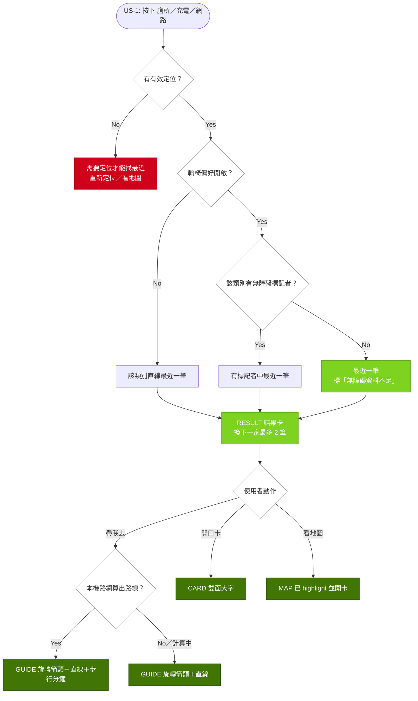

# Implementation Plan: add-three-urgencies-flow

## Overview

v6／survival 分支的主流程是「歡迎頁 → 出發 → 地圖選類別 → 點店家」，急用者要三步才到一家，到門口也沒有開口的工具。本 change 把首頁換成三顆大按鈕（廁所／充電／網路），一鍵出「直線最近一家」結果卡，再分流到導引、開口卡或完整地圖；現有地圖與四個生存亮點全部保留，降為第二層。

策略是**擴充既有 `setView` 狀態機而不重寫**：welcome／explore／guidance 三態改為 home／result／guide／card／map 五態，guide 與 map 沿用同一個 `#explore-screen` 地圖舞台。新增 `urgency.js`（最近一家排序）；開口卡直接接已完成的 `speak-card-strings.js`＋`speak-card.js`＋`speak-card.css`（`window.FriendlySpeakCard`）。距離、方位、步行路線、倒數委派既有 owner；guide 的旋轉箭頭與倒數掛點是既有程式沒有的，明確新增。

## Technical Context (Greenfield)

> AI Knowledge 未建立，以下由實作工作樹 `tcf-three-urgencies-20261108`（HEAD e479b2e）掃描。

- **Stack**：無建置的原生 JS（IIFE／UMD，掛 `window.Friendly*`）＋ Leaflet ＋ OSM 本機底圖；測試 `pnpm test:prototype`（`node --test` ＋ python unittest）；正式 `apps/web` 不是本 change 位置。
- **狀態機**：`app.js:19` 初值 `'welcome'`；`app.js:274 setView` 只收三態並切 `#welcome-screen`／`#explore-screen`；`app-ui.css` 以 16 處 `data-view` 選擇器分派版面，`:264` 在 guidance 隱藏 `#bottom-panel`。
- **可重用 owner**：`app.js:67 distance`、`:71 bearing`、`:75 directionName`、`:76 distanceLabel`、`:101 phoneFor`、`:102 sourceHtml`、`:298 focusPoint`、`:299 requestPosition`、`:365` 箭頭旋轉算式（目前只在方向 sheet）；`route-client.js:21 route()`（第一步 `cancel()`，每次新 Worker 載 20,758,759 bytes 路網，10 秒逾時）；`highlights.js:165 resetTimer`、`:168 startTimer`、`:94 refreshBudget`、`:139 drawBattery`。
- **卡片動作**：`selectedCard`（`app.js:235-237`）有導航、撥號、資訊、方向；`showDetails` sheet（`:344-346`）只有複製、導航、方向，沒有撥號。
- **亮點**：`highlights.js:43 active()` 只認 `'explore'`；倒數 UI 畫在 `#highlight-host`（`#bottom-panel` 內）；`update()`（`:293-296`）位置一變且已選廁所就 `scheduleToiletRoute` 重開 Worker 並 `resetTimer`；`:260-264 batteryChanged` 低電量自動 `open('battery')`。
- **打包與離線**：`tools/package-friendly-prototype.py:11-35` 有獨立 ASSETS 白名單，`:55` 以內容雜湊替換 `friendly-resource-v6-20261107`；`scripts/build-friendly-app.mjs:91` 以 `/friendly-resource-v6-[a-f0-9]{16}/` 驗版本；`sw.js:9-17` ASSETS 22 項；`friendly-offline.test.cjs:9` 有同字面值 VERSION 常數，`:91-96` 斷言 22。
- **資料**：5,948 筆；wifi 3,936／toilet 2,109／charge 406／accessible 1,021（廁所且無障礙 928），無障礙以 `services.includes('accessible')` 判定。
- **設定與返回**：既有 key 只有 `friendly-theme-v6`（`app.js:399`、`:441`）；`app.js` 無 `history`／`popstate`；test runtime（`friendly-app-state.test.cjs:122-140`）也沒有 `history`。
- 建議之後跑 `prospec knowledge init` ＋ `prospec-knowledge-generate`。

## Affected Modules

| Module | Impact | Changes |
|--------|--------|---------|
| `friendly-route/app.js` | High | 五態 `setView`、`history.state` 返回、home／result、guide 箭頭與獨立路線、開口卡入口、設定 |
| `friendly-route/index.html` | High | `#home-screen`、`#result-screen`、guide 箭頭與倒數掛點；移除出發鈕、交通偏好、首頁雷達；載入新檔 |
| `friendly-route/app-ui.css` | Medium | 16 處 `data-view` 改名、home／result 樣式，沿用紫橘 |
| `friendly-route/highlights.js` | Medium | `active()` 認 map、`openToilet`、`guideHost` 綁定與 `renderGuide`、guide 專用圖層、低電量自動開啟條件 |
| `friendly-route/urgency.js`（新） | Medium | `rankNearest` |
| `speak-card-strings.js`／`speak-card.js`／`speak-card.css` | Low | 已由另一 agent 完成，本 change 只接線，不改內容 |
| `sw.js` | Low | ASSETS 加 4 檔（22 → 26），VERSION 字面值不動 |
| `tools/package-friendly-prototype.py` | Low | ASSETS 加同 4 檔 |
| `scripts/build-friendly-app.mjs`、`scripts/check-friendly-route-browser.mjs` | Low | build 不改（v6 雜湊格式不變）；browser 腳本 `:80-82` 入口改為首頁 |
| `docs/prototypes/tests/*` | Medium | app-state 8 案例改入口、history stub；offline 數量 26（`:9` VERSION 不動）；新增 urgency 測試 |
| 原型 `README.md` | Low | 開口卡校對人與日期表 |

## Call Chain

- **開啟 → home**：初始化 → `history.replaceState({ view: 'home', depth: 0 })` → `applyScreen()` → `setView('home')` → `renderHome()`（定位語句沿用 `renderPosition`）→ `requestPosition()` ＋ `cacheData()`
- **按鈕 → result**：`click [data-urgency]` → `openUrgency(category)` → 無有效定位則 `renderResult({ needLocation: true })` → `FriendlyUrgency.rankNearest(stores, position, { category, stepFree, limit: 3, distance })` → `state.result` → `pushScreen({ view: 'result', urgency })` → `renderResult()`
- **帶我去 → guide**：`click [data-action=go]` → `startGuide(store)` → `selectResource(id)`（不再自動換 view）→ `pushScreen({ view: 'guide', urgency, storeId })` → rAF 內 `focusGuidance()` → `renderGuidance()` 出旋轉箭頭＋「直線 X」 → 背景 `scheduleGuideRoute(store)` 用 `guideRouteClient.route({ points, stores: [], radius: 250 })` → 成功補「步行 Y · 約 N 分鐘」，廁所才呼叫 `highlights.openToilet(store, state.guideRoute)` 在 `#guide-timer` 出倒數
- **開口卡 → card**：`click [data-action=speak]`（結果卡或 `selectedCard`）→ `speakCategory(store)` → `pushScreen({ view: 'card', base, urgency, storeId, category })` → `FriendlySpeakCard.openSpeakCard({ category, lang: prefs.lang, onClose: goBack })`
- **看地圖 → map**：`click [data-action=map]` → `openMap({ category, storeId })` → `state.filters = new Set([category])` → `selectResource(storeId)` → `pushScreen({ view: 'map', urgency, storeId })` → rAF 內 `focusPoint(store)`
- **返回**：畫面內返回鈕（`#map-back`、開口卡關閉、`#exit-guidance`、`#guidance-end`、結果卡返回）→ `goBack()` → `history.back()` → `popstate(event)` → 開口卡開著則 `closeSpeakCard({ silent: true })` → `applyScreen(event.state || { view: 'home' })`（依 view 還原 `state.urgency`、`selectResource(storeId)`、`setView`，不再 push）；「回首頁」→ `history.go(-depth)`

## User Story Flow

## Implementation Steps

1. **新增 `urgency.js`：最近一家排序**
   - `rankNearest(stores, position, { category, stepFree, limit, distance })` 回 `{ items, stepFreeFallback }`；類別比對 `services.includes(category)`，同距離依輸入順序穩定排序，`limit` 3。`distance` 注入 `app.js:67`，不寫第三份 haversine。
   - 不用 `visibleStores`（`app.js:81`）或 highlights `nearby`（`:48`）：前者受地圖視窗限制，後者無定位時退回地圖中心，都違反 US-1.2／1.3。照 `highlight-math.js` 的 UMD 外殼，可直接 `require` 測試。
2. **`app.js` 五態狀態機與 home／result**
   - 先 grep 全部 view 字面值再改：`app.js:19`、`:90`、`:151`、`:160`、`:163`、`:168`、`:172`、`:274-281`、`:292-297`、`:305`、`:426-427`、`:444`、`:446`，以及 `highlights.js:27`、`:43`。`:297 selectResource` 刪掉「welcome 時自動 setView」，由呼叫端決定畫面。
   - `card` 是覆蓋層：`state.view = 'card'` 時，畫面顯示與 `#app[data-view]` 取該筆 entry 的 `base`（result 或 map），避免地圖版面被重排。
   - 新增 `renderHome`、`openUrgency`、`renderResult`、`nextResult`；結果卡用 `distanceLabel`、`directionName(bearing())`、`sourceHtml`、`phoneFor`，網路類別標「免費 Wi-Fi 熱點，不保證訊號」，精度大於 100 m 時距離前加「約」。
   - 返回改存在 `history.state`，不用 `returnView` 單槽位。每次前進 `pushScreen(entry)`，entry 為 `{ view, base, urgency, storeId, category, depth }`；`popstate` 只依 `event.state` 呼叫 `applyScreen`，沒有 state 就回 home。
   - 畫面內所有返回鈕一律呼叫 `goBack()`，有 history 時就是 `history.back()`，所以返回堆疊和 app 狀態只有一份來源；開口卡被 `popstate` 關閉時用 `closeSpeakCard({ silent: true })`，不再觸發 `onClose` 而多 push 一筆。
   - 例：home → result → map → 地圖卡開口卡，連按返回依序回 map、result、home，第四次才離開微服務。沒有 history 的環境（test runtime）改用 `state.screenStack` 陣列模擬同一套 push／back。
   - 移除 `TRANSPORTS`、`state.transport`（`:13`、`:19`、`:258-259`、`:403`）；從 home／result 進 map 或 guide 時，`focusPoint`／`focusGuidance` 照 `startGuidance`（`:293`）放進 rAF，排在 `setView` 的 `invalidateSize`（`:281`）之後。
3. **guide：新增旋轉箭頭與獨立步行路線**
   - `index.html:81` 的固定指南針換成 `#guide-arrow`；把 `:365` 的旋轉算式抽成 `arrowRotation(position, store)`，`renderDirection` 與 `renderGuidance` 共用；`orientation()`（`:374-377`）在 view 為 guide 時也呼叫 `renderGuidance`；HUD 加啟用方位感測鈕（沿用 `enableOrientation`）。
   - 文字改為分開標示：`#guidance-distance` 寫「直線 X」，`#guidance-bearing` 只寫方位與「正北基準」，拿掉「（非步行路線）」；新的 `#guide-walk` 只在路線成功時出「步行 Y · 約 N 分鐘」（`route.estimateMinutes`）。
   - `scheduleGuideRoute(store)` 用獨立的 `guideRouteClient` 與 `state.guideGeneration`，不共用 `routeClient`，所以 `requestPosition` finally 的 `scheduleRoute`（`:310`）和目的地路線不會互相取消。只在進入 guide 和按重試時計算，位置更新不重算；失敗或逾時維持只有箭頭。
   - 有目的地時：guide 期間把 `destinationRouteLayer` 移出地圖（`renderDestinationRoute`，`app.js:116-124`），離開時加回；`focusGuidance`（`:286-289`）在 guide 改以 `[position, store]` 或成功後的 guide 路線 fit，不先 fit `state.route`。
4. **highlights.js 對應三急**
   - `active()` 改認 `'map'`；`onOpenExplore` 改成 app 的 `setView('map')`；`snapshot` 加 `urgency`（當前急用類別）。
   - 倒數掛點：`create()` 多收 `guideHost`（`#guide-timer`）；view 為 guide 且 urgency 為 toilet 時，由新的 `renderGuide()` 把精簡倒數（水球、剩餘秒數、開始／暫停／重設）寫進 `guideHost`。`render()` 只管 `host`，`click()` 結尾改為 `render()` 再 `renderGuide()`，兩者各自重繪，guide 不再落到 `render()` 的 `!visible` 分支。
   - `guideHost` 綁同一個 `click` handler（照 `:285` 對 host 的綁法），`destroy()` 一併解除；精簡倒數只有按鈕，不需綁 input／change。guide 端倒數數字用 `data-hl-countdown` 屬性，不用 `#hl-countdown`，避免與 `#highlight-host` 殘留內容重複 id；`tick()` 兩處都更新。
   - `openToilet(store, route)`：設 `selected`、`toiletRoute = route`、`toiletStatus = 'ready'`、`routeKey = store.id 與 positionKey() 組成的同一格式`，然後 `resetTimer()`；使用者按開始才 `startTimer()`。app 只在 `scheduleGuideRoute` 成功後呼叫 `openToilet`；之前由 app 自己的 `#guide-timer-status` 顯示「步行路線計算中，完成後可倒數」，失敗顯示「需要步行路線才能倒數」，`#guide-timer` 保持空白、沒有可按的開始鈕。`update()` 看到注入的路線時，位置改變也不呼叫 `scheduleToiletRoute`；地圖頁自己算的路線維持原行為。
   - guide 圖層獨立：新增 `guideLayer`（layerGroup），guide 生存圈畫在這裡，`clearLayers()`（`:119`）不碰它，所以曾開過雷達（mode 不為 null）時 `update()` 的 `render()` 不會清掉 guide 圖層。view 為 guide、urgency 為 charge、`budget.active`（含手動試玩）時繪製，位置或電量鍵改變時重繪；離開 guide 或換類別時在 `update()` 內 `guideLayer.clearLayers()`。`batteryChanged` 只在 view 為 map 時自動 `open('battery')`；跳過時不把 `deviceWasLow` 設為 true，下次在地圖頁收到電量事件仍會觸發。
5. **開口卡接線（`speak-card*.js` 已完成，不改內容）**
   - `index.html` 在 `app.js` 前依序載入 `speak-card-strings.js`、`speak-card.js`，`<head>` 加 `speak-card.css`。
   - 入口：結果卡的「開口卡」，以及 `selectedCard`（`app.js:237`）route-actions 在導航、撥號旁加 `data-action="speak"`；click 委派加在 `app.js:400`。`showDetails` sheet 不加。
   - 類別：`speakCategory(store)` 有急用類別且店家具備就用它，否則取 `store.services` 中第一個屬於 toilet／charge／wifi 者；三類都沒有就不渲染開口卡鈕，避免 `planSpeakCard` 對未知類別拋錯（`speak-card.js:27`）。
   - 還原：關閉一律 `goBack()`，回到開卡前那筆 entry，由第 2 步的 `applyScreen` 還原。來源是結果卡就回結果卡；來源是 `selectedCard` 就回 map，並以 entry 的 `storeId` 重新選取，卡片留著。開卡前 `setView` 會先 `closeSheet()`，避免 modal dialog 蓋住覆蓋層。
   - 正式流程呼叫 `openSpeakCard` 不帶 `includeUnreviewed`（預設 false）；`speak-card-demo.html` 不進打包。
6. **設定與頁面重整**
   - `openSettings`（`app.js:394`）加母語（只列 `getAvailableLangs()`）與輪椅／推車開關；存 `friendly-native-language-v1`（`zh-TW|en|id|vi`）與 `friendly-step-free-v1`（`1|0`），寫法照 `:399`／`:441` 的 try/catch，讀到未校對值退回 `zh-TW`。
   - `index.html` 刪 `#enter-app`、`#highlight-launch`、`.transport-section`，保留地圖頁 `#highlight-map-launch`；home 放三顆 `data-urgency` 大按鈕、定位行、重新定位與「看地圖」「設定」；`#guide-timer-status`＋`#guide-timer` 放在 `#guidance-controls`（`index.html:87-90`）而不是 HUD，HUD 拆成上下兩段，避免 `max-height: 42dvh`（`app-ui.css:270`）在 390px 捲動時把倒數捲出畫面；地圖頁的 `#start-guidance` 保留（browser 腳本 `:108-109`、`:292` 仍用它）；`highlights.js` 前加載 `urgency.js`。
   - `app-ui.css` 16 處 `data-view` 改為 guide／map／home，重寫 `#welcome-screen` 顯隱規則以涵蓋 home／result，刪 `.welcome-*`。
7. **離線、打包、文件與測試**
   - `sw.js:9` 與 `tools/package-friendly-prototype.py:11-35` 都加 `urgency.js`、`speak-card-strings.js`、`speak-card.js`、`speak-card.css`（sw 22 → 26）。**不手動升 VERSION**：打包依內容雜湊蓋版本，`build-friendly-app.mjs:91` 只認 v6 格式；`friendly-offline.test.cjs:9` 常數不動，`:91-96` 的 22 改 26。
   - 新增 `friendly-urgency.test.cjs`（三類別最近者、換下一家順序、輪椅兩案例、同距離穩定）；`friendly-speak-card.test.cjs` 由開口卡作者維護。`friendly-app-state.test.cjs` 的 seam（`:147`）加新函式，runtime 注入 `history` stub（記錄 push／back 並觸發 popstate）測巢狀返回；在 vm 內執行 `urgency.js` 取得真的 `FriendlyUrgency`，`FriendlySpeakCard` 注入記錄呼叫的 stub；`FriendlyHighlights` 在 app-state 中仍不載入，guide 倒數、遮罩清除改用瀏覽器腳本與手測驗證，不宣稱單元測試已覆蓋；改寫 8 個案例（`:350`、`:367`、`:389`、`:403`、`:426`、`:465`、`:575`、`:593`），`:374` 斷言改為「直線」標籤，不再比對「（非步行路線）」。
   - `scripts/check-friendly-route-browser.mjs:80-82` 改為點首頁「看地圖」並等 `data-view === 'map'`，再補五畫面 390px 截圖，其中須含「guide＋廁所倒數」與「home→result→map→開口卡→連按返回」兩個狀態；README 加校對表；`pnpm test:prototype` 與 `pnpm app:build` 全綠。

## Risk Assessment

| Risk | Impact | Mitigation |
|------|--------|------------|
| app.js 與 highlights.js 同時改，view 名與 `update()` 介面錯位 | High | 步驟 2 先 grep 全部字面值成清單；步驟 2、4 同一人依序做，兩檔一起跑 app-state 測試 |
| app-state 8 個案例依賴舊入口，vm 無 `history`、無新模組 | High | 無 history 時退回 `state.screenStack`；runtime 注入 history stub、真 `urgency.js` 與 `FriendlySpeakCard` stub；只換入口，GPS、卡片、外部動作的斷言保留 |
| 20 MB 路網阻擋 home／result，或多個 Worker 同時載入 | High | home／result 不呼叫路由；guide 先出箭頭、路線在背景算；`openToilet` 沿用 guide 路線；有目的地時最多兩個 Worker（guide 與目的地），列為實機觀察項；若 Android WebView 記憶體吃緊，退路是 guide 期間暫停目的地重算（`requestPosition` finally 跳過 `scheduleRoute`，離開 guide 再補算） |
| 打包白名單漏檔，線上 404 | High | `tools/` 與 `sw.js` 同步加 4 檔；跑 `pnpm app:build` 確認 dist 內有新檔 |
| guide 生存圈的全域暗遮罩殘留，或被雷達 `clearLayers` 誤清 | Medium | 獨立 `guideLayer`，`update()` 依 view／urgency 清除；app-state 無 highlights harness，改以瀏覽器腳本驗「離開 guide 後無遮罩」 |
| TownPass 實機未驗：系統返回是否觸發 popstate（交接 `route-experience.md:14` 支持，但新流程無證據）、全螢幕開口卡、`getBattery` | Medium | 不宣稱可用；Android 實機逐畫面按返回、飛航模式開卡各一次；iOS 沿用交接限制 |
| 翻譯未校對，demo 只有中文單面 | Medium | `reviewed: false` 不上架；中文 `reviewedBy`／`reviewedOn` 目前也是空的，README 照實寫「待補」 |
| 交通偏好殘留文案 | Low | 全文搜尋 `TRANSPORTS`、`transport-status`、「出發」，零命中才算完成 |
| （verifier 第三輪 WARN）頁面重新載入後 session history 仍在，初始化無條件 replaceState home 會讓返回順序顛倒且 `state.result` 不在記憶體 | Medium | 初始化時若已有 `history.state` 就 `applyScreen` 還原（result 依 entry.urgency 重跑排序），沒有才 replace 成 home |
| （verifier 第三輪 WARN）無定位的結果畫面未 push、「換下一家」與定位更新若 push 會灌歷史 | Medium | 無定位的「需要定位」畫面也 `pushScreen`；換下一家與定位更新一律 `replaceState` |
| （verifier 第三輪 WARN）離開 guide 後路線晚到，在非 guide 畫面呼叫 `openToilet` | Medium | 離開 guide 時遞增 `guideGeneration`、cancel `guideRouteClient`、暫停倒數 |
| （verifier 第三輪 WARN）倒數歸零時 `tick()` 只在 `active()` 下 render，guide 端停在暫停鈕 | Low | 歸零分支也呼叫 `renderGuide()` |
| （verifier 第三輪 WARN）`history.go(0)` 會重新載入頁面；測試專用 `screenStack` 分支正式環境用不到 | Low | 只在 depth>0 才 `go(-depth)`；測試只走 history stub，不留 screenStack 分支 |

| Acceptance target | Measured HEAD/version | Baseline value | Measurement command | Target | Gap | Closing mechanism / estimated improvement |
|-------------------|-----------------------|----------------|---------------------|--------|-----|-------------------------------------------|
| 按鈕到結果卡 3 秒內（US-1.2） | e479b2e，Node v24.18.0，桌機 | 等效排序（三類別篩選＋haversine 排序取 3）中位數 1.07 ms（verifier 重跑 1.14 ms）；手機未量測 | node 載入 `resources-data.js` 跑三類別排序 20 次取中位數；實作後以瀏覽器腳本量點擊到 `#result-screen` 顯示 | ≤ 3,000 ms | 計算面遠低於目標；實機端到端值未知 | 計算不需加速；無定位時直接出「需要定位」，不等待定位 |

## Simpler Alternative

不做五態：在現有 welcome 放三顆按鈕，按下即 `setView('explore')`、設 `state.filters` 並 `selectResource` 最近一筆。這樣只改 app.js、index.html、css 和測試四個檔，但會放棄四件事：首頁不出地圖的結果卡、輪椅退路標示、開口卡（US-2 整個不交付），以及返回鍵回結果卡。急用者仍會落在地圖上，正是副局長點名的問題，所以不採。

| Approach | Files | Lines (order of magnitude) |
|----------|-------|----------------------------|
| Chosen: 五態＋urgency.js＋接開口卡 | 14 | ~900 |
| Alternative: welcome 三鈕跳 explore | 4 | ~120 |
