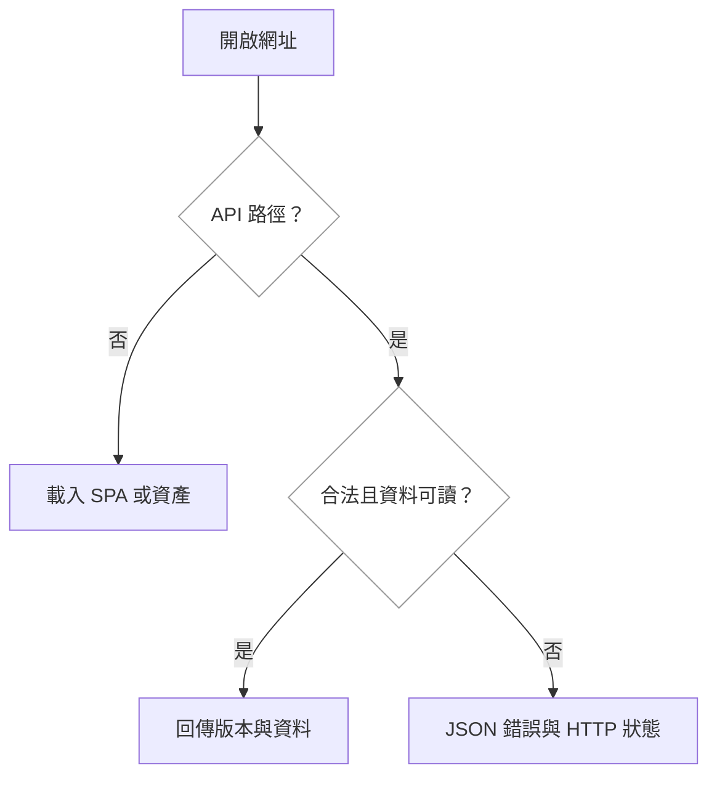
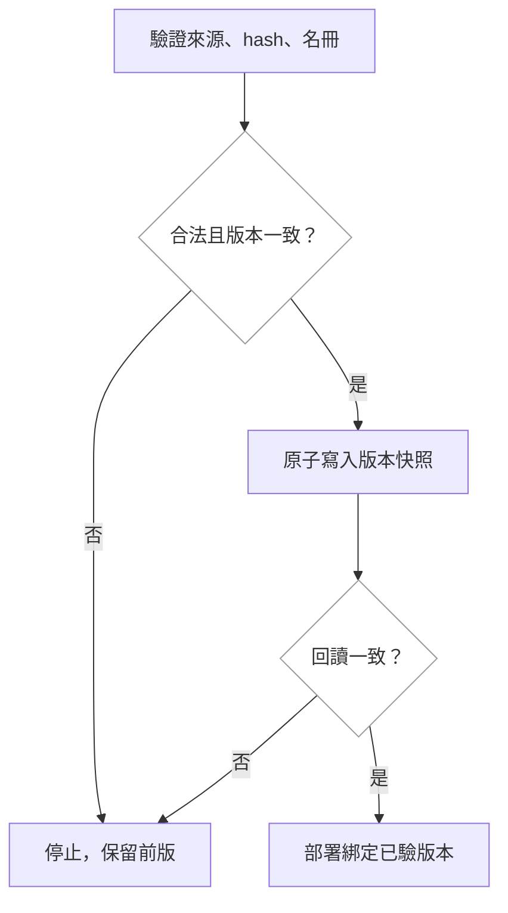
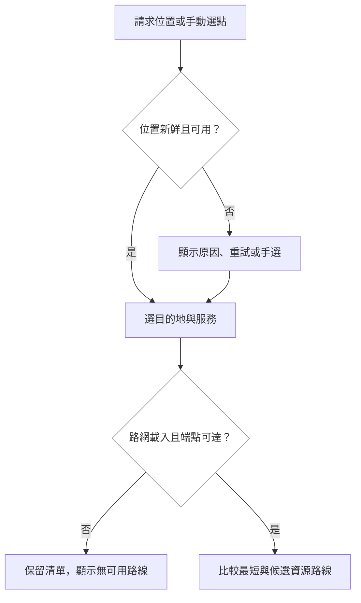
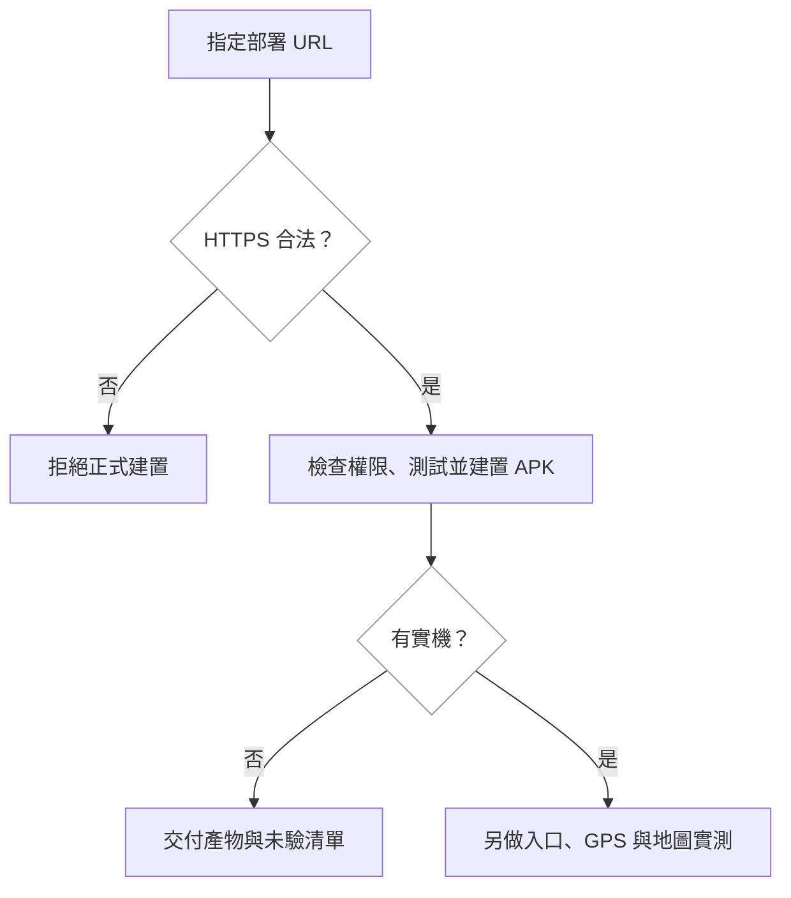
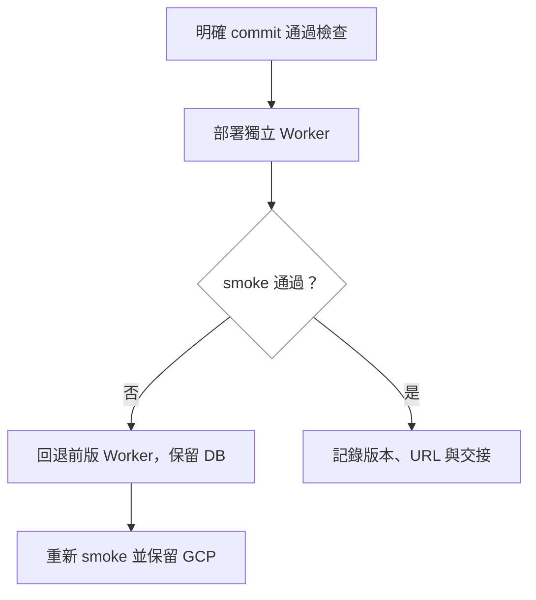

# 實作計畫：友善平台與 App 部署

## Overview
選 option-a：新增 Worker 與 D1 友善資料入口，保留既有 Node/PostGIS/GCP。正式 Vue 整合真實名冊、MapLibre、定位與裝置端路由；組員的 prototype 及產品規格維持原責任。

Cloudflare Static Assets 與 API 同源。資料先整理為獨立版本化快照，D1 儲存原子快照記錄，Worker 明確綁定版本；先部署 workers.dev，再依 Ci 回覆決定正式 hostname。TownPass 在獨立 repo 建置指向已驗證 HTTPS 入口的 APK。評論、真人求助、全市路由及完整離線包另由產品規格接續。

## Technical Context (Greenfield)
### Tech Stack Detection
- TypeScript、pnpm；Hono + Zod；Vue 3 + Vite + MapLibre；Vitest。既有 Drizzle/PostGIS 留在 Node 入口。
- Knowledge index、module-map 尚空，沒有正式 Feature Spec；以下路徑是程式責任區，不假稱已登錄模組。
### Project Structure Scan
- `apps/api/src/index.ts` 組裝 Node，`app.ts` 掛 health/places/opendata；`db/client.ts` 有 pg 全域狀態，Worker 不 import 這條依賴鏈。
- `apps/web/src/router.ts`、`pages/MapPage.vue` 為現有 Vue/MapLibre 入口；`lib/api.ts` 使用 Zod 驗回應，`useTownPassBridge.ts` 提供 native/browser bridge。
- `packages/shared/src` 持有共同契約；`docs/prototypes/friendly-route` 是已驗證來源與演算法參照，本輪只讀。
### Detected Patterns
- 公開型別避免 any，輸入驗證在 HTTP／資產邊界；應用邏輯及查詢與 transport 分離。
- 保留原本 Node API 行為與測試；新增純 friendly route 接受 repository，不以 Worker 重寫原 PostGIS 端點。
### External Dependencies
- 新增 Wrangler（MIT/Apache-2.0 依套件 LICENSE 核對）；D1 使用平台 binding，沒有執行期商用地圖或雲端 LLM SDK。
- Context7 已查 Workers SDK、Static Assets SPA routing；官方文件已查 D1 SQL／transaction 邊界。實作匯入前再核對實際 CLI 行為。
### 待補
Knowledge 仍需後續正式初始化；本輪以實際路徑、來源與測試證據交接。
### 候選評估
`prospec validate candidates --change deploy-friendly-platform` 實際輸出：

| option | direction_violations | touched_modules | estimated_lines | unknown_references |
|---|---|---|---|---|
| option-a | 0 | 0 | 3400 | 26 |
| option-b | 0 | 0 | 4600 | 66 |

零違規因 module-map 空白，不能解讀為已驗證分層。行數是候選估算。A 改動面較小；B 需要全面抽象化既有 API 與雙 DB 相容，本輪沒有這項產品需要。比較由同一 orchestrator 依候選單向判斷，非盲評；詳見 decision.json。

## Affected Modules
| 實際責任區 | 影響 | 變更 |
|---|---|---|
| packages/shared | 高 | friendly/platform 契約、純路由與測試 |
| data/friendly | 高 | 版本化名冊、來源 manifest、路網及底圖 |
| apps/api | 高 | Worker 組裝、friendly route、D1/snapshot repository；Node 加掛同 route |
| apps/web | 高 | FriendlyMapPage、位置／地圖／路由 adapter、首頁導覽與來源 |
| scripts、Wrangler、CI | 高 | 獨立 D1 schema、可重跑匯入、版本產物、smoke、回退 |
| TownPass 外 repo | 中 | HTTPS 建置腳本、coarse/fine、APK 與證據；不計成本 repo 模組 |
| docs | 中 | 契約、部署、責任與待實機清單；不改組員 prototype/spec |

## Call Chain
跨層命名型別為 FriendlyStore、FriendlyQuery、FriendlySnapshot、SourceManifest、PlatformConfig、LocationResult、RouteRequest、RouteComparison；具體匯出由 shared 統一。

```text
GET /api/v1/friendly-stores
 → worker.fetch(Request, Env) → edgeApp.fetch → friendlyRoute(FriendlyQuery)
 → FriendlyRepository.read(version): FriendlySnapshot
 → D1FriendlyRepository.read(version) → D1.prepare/bind/first
 → queryFriendly(snapshot, query): FriendlyStore[] → validated JSON
GET /api/v1/sources
 → friendlyRoute → FriendlyRepository.read(version) → SourceManifest
GET /config
 → edgeApp → platformRoute → publicConfig(Env): PlatformConfig
GET /healthz
 → edgeApp → platformRoute → FriendlyRepository.read(version) → readiness JSON
未知 /api/* → edgeApp.notFound → JSON 404（不進 SPA）
GET / 或 /map → Static Assets → Vite main → router → FriendlyMapPage
Node /api/v1/friendly-stores、/api/v1/sources、/config
 → index → app → 同 friendly/platform route → SnapshotRepository
名冊畫面 → friendly-api → 既有 apiGet + shared schema → 地圖／清單
定位／重試 → useFriendlyLocation → location adapter → native bridge 或 browser geolocation
手動選起點 → location generation 失效舊請求 → RouteRequest
路線比較 → route adapter → shared routing.compare(graph, stores, request) → RouteComparison
地圖呈現 → map adapter → MapLibre GeoJSON（lng,lat）→ markers/lines
資料準備 → import-friendly script → shared schema → hash/版本驗證 → D1 單一快照 INSERT
部署 → release-platform → 明確 commit 產物 → wrangler deploy → smoke-platform
回退 → wrangler rollback(先前 version) → smoke-platform（資料不回退）
App → build-townpass wrapper → 外 repo build-codefest.sh(HTTPS URL) → Flutter → APK/hash
```

### 原子資料發佈
本輪名冊規模採一列 immutable snapshot（version 主鍵、stores JSON、manifest JSON、內容 hash），避免多列 staging 與公開管理 API。單一 SQL statement 寫完整 snapshot；同版本同 hash 為 no-op，不同 hash 拒絕。Worker `DATA_VERSION` 選明確快照，schema 與前版快照保留；讀不到所選版本回 503。此為 A 的原子匯入具體化，沒有過早引入通用 Publisher。

## User Story Flow
### US-1：入口與錯誤

### US-2：匯入與版本

### US-3：位置與路由

### US-4：Android 建置

### US-5：部署與回退


## Implementation Steps
1. **固定契約與正式來源（US-2、3）**
   - 從已知 prototype 版本提取名冊／圖資到 data/friendly；重算檔案 hash 與原始 CSV hash，分開記錄來源宣告與本輪實測；輸出 manifest。
   - 既有資料正規化 owner 是 `docs/prototypes/build-friendly-data.py`，路由 owner 是 `docs/prototypes/friendly-route/routing.js`。本輪不改 owner 檔，固定輸出快照後由 shared 接管正式純路由；差異測試鎖同輸入結果。
   - shared 是既有 Zod 契約 owner，新增服務列舉、查詢、回應、來源、位置與路由型別。JSON parser 不再另創容錯資料格式。
2. **新增可部署 API（US-1、2）**
   - friendly route 接受窄 repository；Node snapshot／Worker D1 共用查詢規則。D1 失敗、缺版本、schema/hash 不符皆回錯誤，無假資料 fallback。
   - 新快照 writer 搜尋 module-map（空）、現有 seed 與 release 腳本後無適用 owner：pg seed 是另一資料與 schema，不能重用為 D1。新 importer 僅寫獨立 D1，一個 SQL statement 與版本主鍵確保原子／可重跑；回讀核對。
   - 四服務 OR、bbox 或附近查詢，驗 lat/lng/radius/limit；空集合合法。應用 log 不記 query string，GPS 不落庫；公開 config 只白名單。
3. **正式 Vue 整合（US-3）**
   - 沿用 MapPage 的 MapLibre worker 與樣式、apiGet、useTownPassBridge；新 FriendlyMapPage 接 adapter，首頁與 /map 都能到達。
   - 地方 OSM snapshot 作來源明確的 GeoJSON 底圖。route graph 懶載入、驗 schema，單次快取；map/WebGL 或 graph 失敗保留名冊與重試。
   - 位置保留 source/accuracy/timestamp/reason；browser 給真實錯誤，native [] 顯示未知失敗。技術門檻先採 60 秒新鮮、100 公尺精度並明示可調，低品質不自動當有效起點。手選遞增 request generation，晚到不覆蓋。
   - 不自動將 GPS 傳至 API；本機選服務、起迄點與候選路線，接線以虛線標示未驗證；沒有完整離線時明示網路需求。
4. **部署與回退（US-1、5）**
   - root Wrangler 設定 Assets SPA、只對 /api/*、/healthz、/config worker-first。使用獨立 D1／workers.dev，來源 SHA 作公開版本。
   - 既有 `deploy/release.sh` 是 GCP writer，會打包工作樹與 force schema；本輪有意新增 Cloudflare writer，僅建明確 commit 的 web/assets/API，不碰舊 deploy。
   - CI 保留 PostGIS 測試、加入 D1 local integration 與 SPA/API smoke。部署工作 concurrency 防同環境互撞；本機 release 拒絕 dirtytree，metadata 非前端敏感資料。
   - 回退只指先前 Worker version；相容 schema／資料版本保留，D1 不自動倒退，先檢查舊版本仍可讀。GCP 健康另核對。
5. **App 交付（US-4）**
   - 重用外 repo CODEFEST_SERVICE_URL、`scripts/build-codefest.sh`，補 HTTPS 驗證與 coarse permission；不另建第二個 Flutter app。
   - 以已驗部署網址 build，記兩 repo SHA、URL、APK SHA-256、建置／manifest 結果。debug signing 明示展示用途；ADB 無裝置時不宣稱實機通過。
6. **獨立驗證與交接（全部）**
   - root typecheck/lint/test/build；真實 local D1 匯入重跑、API邊界、已部署 smoke、回退與重部署；手機寬度 browser 操作。
   - fresh-context review 及 Claude Code Opus 5.5 協作核對實際 diff；修復後重跑受影響檢查。
   - 契約、正式程式與 prototype 的責任分界寫 docs/handoff 與 RUNBOOK；公開網址與 APK 交接，未驗項明示。

## Risk Assessment
| 風險 | 影響 | 緩解 |
|---|---|---|
| Node 與 Worker 不同 API 集合 | 中 | 明示 places/opendata 為 Node legacy；正式首頁與 map 只用 friendly，未知 API JSON404 |
| D1 無 PostGIS、版本快照漸大 | 中 | 本輪地方小快照讀取後純查詢，記限制；全市擴充另量測，無宣稱可無限擴充 |
| 不同版本同 key 覆寫 | 高 | importer 核對 hash，immutable 版本；一筆原子寫入、回讀；Worker 明確 DATA_VERSION |
| Worker 回退不等於 DB 回退 | 高 | 追加式 schema、留舊快照、回退前確認資料相容，演練 Worker rollback |
| 純路由與 prototype 分岔 | 中 | 固定來源與差異測試，正式 shared owner 清楚交接；不回寫組員原型 |
| GPS 過期或晚到覆蓋 | 高 | timestamp／accuracy／range 驗證、generation取消、手動入口與錯誤測試 |
| 地圖／圖資錯誤、手機主執行緒壓力 | 中 | 資產懶載入、有限候選、本地實測並保留清單；不宣稱全市導航 |
| 公開位置／secret | 高 | 裝置計算、無 GPS 儲存、不記 query；config 白名單、secret 走 env |
| APK 與實機結果混淆 | 中 | 記 build 與 manifest 證據；debug signing、無實機、既有測試問題分開揭露 |
| 候選 B 大範圍重構 | 高 | 本輪不選；保留既有健康 Node API，產品規格穩定再評估統一 adapter |
| 正式 hostname 未決 | 低 | 先 workers.dev，既有 DNS/GCP 不改 |

### 獨立架構複核的邊界補強
- Node 與 Worker 都以 pathname 記 log，非 test 啟動時也驗附近 query 不出現在 log；沿用既有 logger owner 改輸入，不能只處理新入口。
- API／圖資請求 15 秒中止並提供重試，定位 12 秒；卸載或新請求取消前次結果。部署 smoke 每請求 20 秒，有限次重試，不無限等候。
- 本機 deploy／rollback 使用同環境互斥鎖，並核對操作前的 Worker version；第一次部署無前版時停止交付新入口、保留 GCP，不宣稱已回退。
- tasks 採最終單列 snapshot 計畫；候選中的 batch 僅為比較歷史，無第二套 writer。
- TownPass 工作位置固定為隔離 `TownPass-platform`，重用已完成的 parser／權限變更並做後續 APK 驗證，不重寫它們。

### Quantitative Target Baseline
提案沒有延遲、效能或覆蓋率數值目標；筆數、服務類別與演算法限制是固定資料／契約，不冒稱效能量測。驗證結果於實作後記錄，不以預估時間代替實測。
