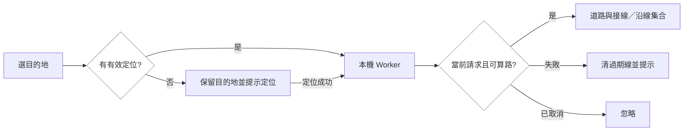

# 實作計畫：目的地沿途資源與 TownPass 返回

## 技術摘要
Knowledge 為 Greenfield（module-map 空、沒有 Feature Specs），實作為既有 Brownfield：平台 18dffb3 的純 JS／Leaflet／CSS 原型與 Flutter 7180078。部署入口是 docs/prototypes/friendly-route，而非 apps/web。保留既有設計與元件。
路由重用 routing.js 的 OSM 最短路徑及沿線幾何，新增 shortest-only 入口與 Worker 介面，GPS 不離開裝置。基線圖只有信義／大安東側；Ci確認本機方案後，建置期用官方Overpass固定臺北市行政區道路及完整引用節點擴圖，不因使用者位置查遠端；無路仍明確失敗。
本輪不新增後端、資料庫、登入、互助或交通方式。iOS 離線快取限制維持如實提示。

## 影響範圍與重用
| 邏輯模組 | 檔案／影響 | 現有 owner 與證據 |
|---|---|---|
| 本機路由 | routing.js、routing-worker.js、route-client.js、routing-data.js、build-friendly-routing.py／中 | routing.js 的 compare、resourceIds、routeGap、shortestTree；新增 shortest 模式避免替代路線搜尋；沿用builder的access及foot限制 |
| App 狀態與地圖 | app.js、index.html、app-ui.css／高 | setDestination、requestPosition、visibleStores、renderAll、setView；同一 Leaflet 地圖，獨立目的地線與選取資源線 |
| 離線與打包 | sw.js、package-friendly-prototype.py、app-shell-smoke.mjs／中 | 現有 ASSETS／APP_SHELL 清單；新增靜態路由程式與公開圖，仍不快取 GPS／查詢／個人路線 |
| 原生殼（另一 repo） | tp_route.dart、home_view.dart、main_view_controller.dart、codefest_view.dart／高 | 9701688 原有 MainView＋bindings，既有 CodefestView 橋接／重試／地理來源檢查 |
| 測試 | prototype 狀態、路由、離線／打包測試；TownPass launch/service 測試 | 重用現有測試 harness，不以 DOM double 證明真實 RWD |

## 實作步驟
1. 資料與路由 domain：builder串流讀官方Overpass XML，參數化範圍、保留各連通分量、runtime省略未用OSM IDs與edge way IDs，保留幾何及來源hash；不改API的data/friendly快照。新增query與builder測試。加shortest-only及沿線集合；固定公開座標測成功／拒絕／斷開圖。
2. Worker adapter：建立本機路由請求介面、請求序號、終止、逾時、錯誤轉換；不存在 Worker 時明確不可用，不改遠端 API。只在記憶體傳座標。
3. App controller：GPS＋目的地觸發路由；晚到 GPS 可補算；更換／清除／定位失敗取消舊任務。地圖、清單、數量從同一 storeIds＋類別集合推導，點資源不抹除目的地線。
4. UI：停止 pointer 進入時的強制聚焦，Tab 保留 focus-visible；START 改緊湊 44px 高，短文案。新增展開地圖及收合浮動面板，ResizeObserver 監看 map-stage，fitBounds 留面板空間。
5. 原生殼：恢復 MainView 根路由，未自訂時進入首頁，保留既有起始頁偏好；首頁和原有服務入口導向 /codefest。CodefestView 加明確返回台北通，系統返回保留網頁歷史優先；其餘服務維持原行為。
6. 同步資產清單與測試，產出可部署 app bundle；跨尺寸瀏覽器實測、Flutter 測試與原生安裝後驗證；補決策與交接，獨立 review 後發布既有部署。

## 呼叫鏈與狀態
- 搜尋結果 → setDestination → scheduleRoute → RouteClient → Worker → FriendlyRouter shortest → route state → 共用 visibleStores → 地圖／列表／數量。
- GPS 完成或重試 → requestPosition → scheduleRoute；失敗／清目的地 → cancel＋遞增 generation → 清線＋回附近資源。
- 類別／資源選取 → renderAll → 同一 route.storeIds 過濾；不重算道路、不清 destination。
- 展開／收合 → mapExpanded／panelCollapsed → DOM aria／CSS → ResizeObserver → map.invalidateSize；不重建地圖。
- TownPass 啟動 → MainView bindings → HomeView → TPRoute.codefest → CodefestView → TPInAppWebView ready bridge → URL 載入。
- 返回台北通 → native pop；系統返回 → WebView.canGoBack ? goBack : native pop。精確服務 URL 才使用專用容器。

## 量測基線與目標
基線 18dffb3；Chrome headless＋Playwright，2026-11-07。本機 `python3 -m http.server 8883 --bind 127.0.0.1 --directory docs/prototypes/friendly-route`，由 Playwright 對下表 viewport 點 #enter-app 後讀 getBoundingClientRect 與 documentElement.scrollWidth；焦點等待 300ms 再測。完整重跑指令／量測程式記錄於 baseline.md。
| 尺寸 | 水平溢出 px | START 寬 px | 說明行數 | 目標與差距 |
|---|---:|---:|---:|---|
| 320×568 | 0 | 111.59 | 2 | 溢出維持0，說明減為1行 |
| 390×844 | 0 | 130.09 | 2 | 溢出維持0，說明減為1行 |
| 430×932 | 0 | 130.09 | 1 | 維持0與1行 |
| 768×1024 | 0 | 130.09 | 1 | 維持0與1行 |
| 844×390 | 0 | 130.09 | 1 | 維持0與1行，控制可捲動 |
焦點基線：pointer 進入後 search-trigger :focus-visible=true，3px rgb(53,37,205) 外框；目標無非操作焦點框。地圖高度皆360px；新增展開應使用App可用高度並可復原。
差距關閉機制：按鈕14px字／16px圖示、44px高、縮短說明＋minmax(0,1fr)佈局，標準字級預估2→1行（非實測）；大字級改可捲動／可換行，不裁掉必要內容。250m 為新增幾何定義，不是效能改善指標；以邊界點測包含／排除。

## 風險與回復
| 風險 | 緩解 |
|---|---|
| 圖缺路／距路網過遠 | 官方臺北行政區匯出與完整引用節點；仍顯示範圍／接線限制，保留真實位置，不承諾所有目的地可達或無障礙 |
| 舊 Worker 回應覆蓋新路線 | generation＋terminate＋有限逾時；清目的地與定位失敗皆使前請求失效 |
| 手機算路阻塞 | Worker＋shortest-only；不對5948點跑替代路徑compare，不添加同步主緒 fallback |
| 浮層遮路線或控制 | fitBounds padding、固定復原鈕、觸控目標44px；短視窗可捲動；Tab可達性實測 |
| 原生殼回歸 | 保留專用容器、橋接安全與重試，首頁／返回測試，實機確認後保留前版簽名artifact可回裝 |
| 缺模組／Feature知識 | WARN：已讀index、conventions、manifest與針對來源，未虛構模組或現有REQ；由本change建立新增feature |
| 發布與SW新舊資產 | 用現有hash打包、app-shell smoke；測試release bundle；可回復前一Worker版本 |

## Simpler Alternative
直接同步 compare＋原生一般 WebView 約8–10檔、150–250行，但現有5948資源compare單次觀察約5.3秒且一般WebView失去專用bridge防護，故不採用。選方案重用現有router與CodefestView，估計20–25檔、500–900行含測試；沒有新框架／後端。數量是計畫估計，完成後以diff統計。

Knowledge check：WARN — Greenfield知識庫，沒有L2或Feature Specs；已完成來源導向技術摘要，缺口及措施見上。

獨立plan核對補充：Worker需處理window/self全域相容並真實載圖測試；原生直接返回需越過既有PopScope文件歷史攔截。tasks與驗證包含此兩項。缺L2的WARN持續標示。

Ci補充確認本機方案後：新增固定公共區域資料建置，官方count基線64,080 ways／286,385 referenced nodes；最終runtime容量與速度依實際建圖量測，不編估計。完整review與verify包含此補充，未修改驗收情境。

發布驗證補充：App資產以已驗證manifest的bytes作讀取界線，另受25 MiB硬上限與caller較低上限約束；current／historical共用，API與manifest維持通用8 MB讀取限制。新增實際Response stream測試涵蓋合法20.76 MB路網、超量、hash及回退相容，避免正式發布因檢查器大小假設而回退。
